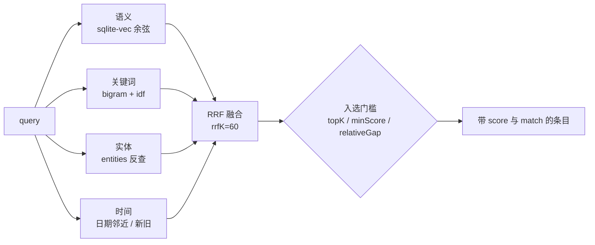
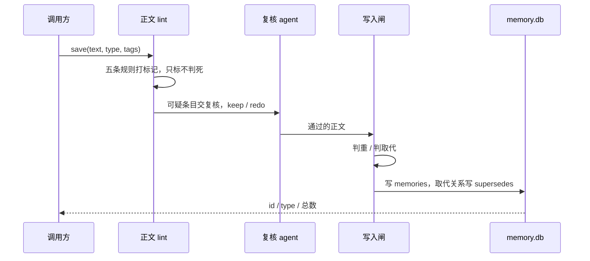
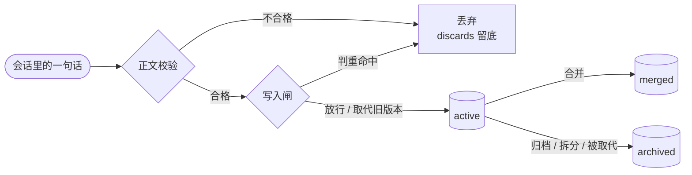
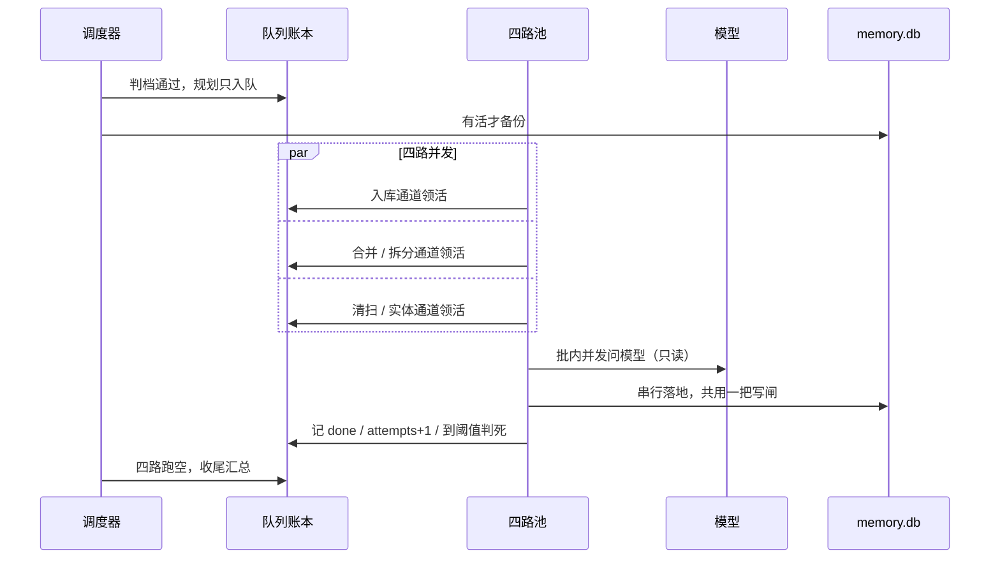
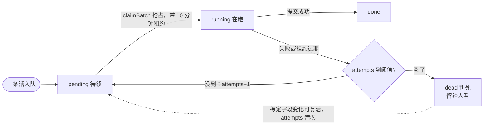

# dsh-memory

DSH 的长期记忆插件。会话里说的一句话，挑该记的写成 `memory.db` 里的一行；下次开口前按意思捞回来，上下文快满时和每天定时各整理一轮。

## 装进来

包名 `dsh-memory`，peer 依赖只有 `@deepseek-ai/dsh-tools`。本仓用 pnpm，`npm ci` 不适用：仓库只带 `pnpm-lock.yaml`，不收 `package-lock.json`。从源码装依赖：

```bash
pnpm install --frozen-lockfile
```

装好之后在 fatfish 的 `cordis.patch.yml` 里插一条：

```yaml
- insert:
    - id: memory
      name: 'dsh-memory'
      config:
        storePath: ./memory
        topK: 8
        minScore: 0.45
```

`storePath` 是目录，库文件 `memory.db` 落在里面，没有就新建。启动日志里能看到一句 `dsh-memory ready: N 条活跃记忆 @ <storePath>`，这句出现就算接上了。配置只在进程启动时读，改完要重启 dsh。

## 它能做什么

四件事，对应四段代码路径：

- 存：十个 `memory_*` 工具里写的那几个，加上每晚从会话记录里自动长出来的。
- 查：`memory_recall` 按意思检索，四路融合；每轮开头还会自动注入几条相关的。
- 整理：合并重复、拆超长、判取代、归档作废，平时攒在队列里，攒到一轮整理时一起做。
- 兜底：上下文逼近压缩线时先整理一轮，别让压缩把细节嚼碎。

## 工具

| 工具 | 干什么 | 主要参数 | 回执 |
| --- | --- | --- | --- |
| `memory_save` | 存一条事实、偏好或决定 | `text`（必填，一条一件事）、`type`、`tags` | 已记住（type，共 N 条）；超长会入队拆分 |
| `memory_recall` | 按意思检索 | `query`（必填）、`k`、`type` | 条目 + 分数 + `match`（被哪几路捞到） |
| `memory_list` | 按新旧列最近存的 | `limit`（默认 10）、`all`、`type` | 共 N 条 + 最近的若干条 |
| `memory_entity` | 看某个实体（人、机器、项目）都记了什么 | `name`（必填）、`limit` | 四类计数 + opinion 平均置信度 + 最近条目 |
| `memory_archive` | 作废一条（软删，行还在） | `id`（必填）、`reason` | 已归档 id（status），共 N 条 |
| `memory_merge` | 把几条合成一条，源条转 `merged` | `ids`（逗号分隔，至少 2 条）、`text`、`type`、`tags` | 合成后的 id 与条数；正文超长改入队 |
| `memory_reflect` | 调一条 opinion 的置信度 | `id`（必填）、`signal` = `reinforce` / `weaken` / `contradict` | 调整后的 confidence |
| `memory_split` | 把超长条目拆成原子条目 | `dryRun`（默认 true）、`ids`、`limit`、`maxChars`、`force` | scanned / tried / split / failed，演练先写预览文件 |
| `memory_consolidate` | 手动跑一遍压缩前整理（自测用） | `transcript`、`limitChars` | 存了几条、花了多少毫秒 |
| `memory_sleep` | 手动跑一轮睡觉 | `dryRun`、`sinceHours` | 读了几个会话、加/合/改/档各几条 |

`memory_save` 只收 `text` / `type` / `tags` 三个参数。实体、日期、取代关系都是服务端的事，别自己填：日期从正文开头的绝对日期反抽，取代由后台整理判。

写类工具（save / archive / merge / reflect / split / consolidate / sleep）执行前都要过 `assertMayWrite`。子会话（subagent）调进来直接抛错，不是提示词劝退，是代码级硬拦。子会话要记的东西写进报告交回主会话落笔。

## 怎么查

四路各自排序，然后 RRF 融合：

- 语义：sqlite-vec 余弦，嵌入走远端 BGE-M3。
- 关键词：中文 bigram 加 idf。
- 实体：query 命中的 `entities` 反查挂载的记忆。
- 时间：query 带日期时按日期邻近，不带按新旧。

融合常数 `rrfK` 默认 60；实体通道再乘 `rankWeightEntity` 默认 0.65（实体好撞不好精，权重压过）。返回的 `score` 仍是余弦原值，不是 RRF 分，`match` 说明这条被哪几路捞到。



门槛只按 `active` 的分数算：归档和合并的条目召回时乘 0.3 降权留个影子，但不能靠高分把在用的条目挤掉。`status` 只认 `active` / `archived` / `merged`，空值按 `active` 读。

## 怎么存

一条记忆 = 一个 type + 一段正文，正文一条只说一件事。

| type | 是什么 |
| --- | --- |
| `world` | 外部客观事实：机器状态、配置、决定、别人说过的话 |
| `experience` | 自己做过的事，第一人称 |
| `opinion` | 判断与结论，带 `confidence`，可被 reinforce / weaken / contradict 调整 |
| `observation` | 观察类条目；按实体聚合时单独计数，不生成摘要 |

正文有 200 字硬闸（`splitMaxChars`）。超了不丢也不截：原样进 `split_item` 队列等拆分 agent 切，回执写「已入队拆分」。`memory_merge` 合并后的正文超长同样入队，原条一条不动。



判重命中进 `discards` 留底；判取代把旧 id 写进新条的 `supersedes`。归档只改状态不删行，合并把源条转 `merged` 并挂取代链，所以每一轮都能顺着链退回去。



## 自动整理

整理链不是一条顺序大函数，是队列 + 池：规划只入队，四个通道的池各领各的活。批指纹没变就整批跳过，空返回也算一次尝试，记进队列账本。


四个通道：`ingest`（会话文件入库）、`curate`（合并 / 拆分）、`compact`（作废清扫 / 重放 / 实体整理）、`entity`（实体抽取，10 分钟一 tick）。通道和 kind 的对应关系只写在 `src/kind-handlers.ts` 一处。

池的语义钉在 `src/pool.ts` 文件头：小批领活（批大小 = 当前并发数，绝不整队标 running）、批内并发问模型、串行落地（几个池共用一把写锁）、空了就等、不收敛不算完。

睡觉一轮从判档开始，到四路池跑空收尾：



调度器先读 `sleep.state.json` 判这一档该不该现在跑；贵时段拦下的过点补跑记成待补（`owedSlots`）。有活才备份 `memory.db`，收尾写回 `lastSleepAt` 和本轮汇总。

账本里一条活只有待领、在跑、完成、判死四种状态，所有通道共用：



租约过期由 reap 捞回待领，失败 attempts 加一。整理类到 5 判死，实体抽取到 3。判死的行留着给人看，不自动清零。

## 存储

一个文件 `memory.db`，正文、向量、账本、实体层都在里面。

| 组 | 表 | 用途 |
| --- | --- | --- |
| 正文 | `memories` | 一条一行，带 `status` / `type` / `ts` / `validFrom` / `supersedes` / `rowSeq` |
| 向量 | `vec_items` / `vec_map` | sqlite-vec 向量与 rowid ↔ 记忆 id 的映射 |
| 元信息 | `meta` | 迁移、向量维度、实体层版本 |
| 账本 | `ingest_files` / `pending_ops` / `discards` | 文件级 ack、待办与判死、丢弃留底 |
| 队列 | `curate_queue` / `curate_run` | 实体抽取待办、每轮运行账 |
| 实体 | `entities` / `memory_entity` / `entity_surface` / `entity_merge` | 实体、挂载、别名、合并凭据 |
| 关系 | `memory_link` | 记忆之间的边 |

别的插件或脚本要读记忆，只走 `src/public.ts` 的 `createMemoryReader()`，别直接连库。睡觉前会在线备份一份到 `backupDir`，走 SQLite backup API。

## 配置

参数全在 `src/index.ts` 的 `Config`：顶层 85 个键；`entityQueue`（13）/ `entityTidy`（1）/ `pipeline`（4）三个子对象展开后，合计 100 项（构建产物实测：`Object.keys(Config.dict)`）。实际部署值在 `cordis.patch.yml`。下表只列常用的 24 项（14 行，部分行合并了同族键），其余看 Config 与源码注释。

| 键 | 默认 | 用途 |
| --- | --- | --- |
| `storePath` | `./memory`（`DSH_MEMORY_ROOT` 可覆盖） | `memory.db` 所在目录 |
| `topK` / `minScore` / `relativeGap` | 5 / 0.45 / 0.1 | 召回条数、语义入选线、与最高分的相对落差 |
| `rrfK` / `rankWeightEntity` | 60 / 0.65 | RRF 常数与实体通道权重 |
| `autoPrefill` | true | 每轮自动回忆注入开关，配套 `autoPrefillTopK` / `autoPrefillTimeoutMs` |
| `consolidateEnabled` / `triggerTokens` | true / 180000 | 压缩前整理的开关与触发量 |
| `sleepEnabled` / `schedule` | true / `[]` | 睡觉开关与多时段；`schedule` 空则用 `hour` / `minute` |
| `priceClockFile` / `sleepDeferInPeak` | dsh-price-clock 的 `lib/clock.js` / true | 贵时段闸与过点补跑推迟 |
| `organizePipelineMode` | `pool` | 队列 + 池；`legacy` 是回滚用的老顺序路径 |
| `organizeIngestConcurrency` / `organizeIngestAdaptive` | 64 / true | ingest 理论上限（代码硬顶 64）与按负载自适应 |
| `organizeConcurrency` | 0 | 全链手工上限，只许往下压，0 = 不覆盖 |
| `pipeline.ingestAck` / `pipeline.writeGate` / `pipeline.agentPipeline` | false / false / false | 文件级 ack、唯一写入闸、MergeAgent 整理 |
| `entityQueue.consume` | false | 实体抽取队列消费开关，10 分钟一 tick |
| `entityTidy.apply` | false | false 只报不合并，true 才自动合确定同义 |
| `splitMaxChars` / `splitItemMaxChars` | 200 / 200 | 拆分门槛与拆出来的单条上限 |

实体名录：`data/entity-lexicon.example.json` 是示例，实际名录由使用者自行维护（放到 `data/entity-lexicon.json`，已 gitignore；也可用 `DSH_MEMORY_LEXICON` 指定路径）。

## 排障

日志都在插件日志目录下，一个环节一个文件：

| 日志 | 看什么 |
| --- | --- |
| `memory_sleep.log` | 每轮睡觉的规划、通道、落地、判死 |
| `memory_recall.log` | 每次检索一行 JSONL（session / origin / callId / hits / ms），对「该查没查」 |
| `memory_store.log` | 迁移、写事务回滚、备份 |
| `memory_entity.log` | 实体队列与抽取 |
| `memory_split.log` | 拆分执行 |

常见三种：

- 该查到的没查到：先看 `memory_recall.log` 这次 query 有没有发出、hits 几条；再拿 `memory_list` 找那一条，看是不是被归档或合并了。
- 队列不收敛：日志里 `attempts` 一直涨但没 `done`，多半是模型空返回或解析失败。空返回也算一次尝试，试到阈值判死，不会自己重来。
- 判死条要复活：只认 batch / ids / items 这些稳定字段，改了每轮变化的错误摘要不会触发复活。

## 开发

源码在 `src/**/*.ts`，`lib/` 是 `pnpm run build` 的产物，进 `.gitignore`，手改会被下一次构建盖掉。构建是 `tsc --noEmit && tsdown`，类型不过就出不来；`prepare` 只在 install 时自动跑，且只有 `tsdown`。切分支、回滚、拉完远端先 `pnpm run build`，否则跑的还是旧产物。

`pnpm test` 跑 `node --test test/`，全量 638 条。测试直接 import `lib/`，所以先构建。
